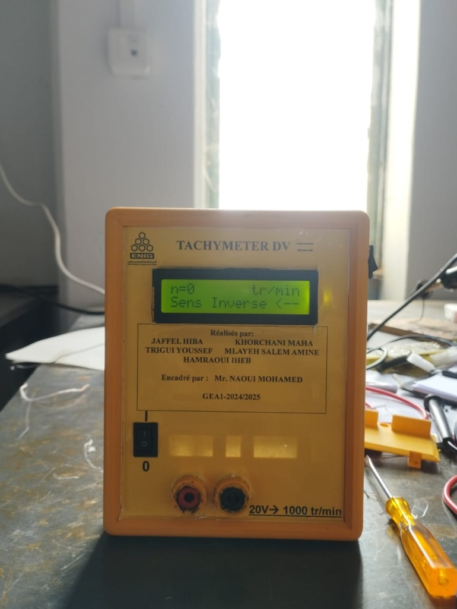
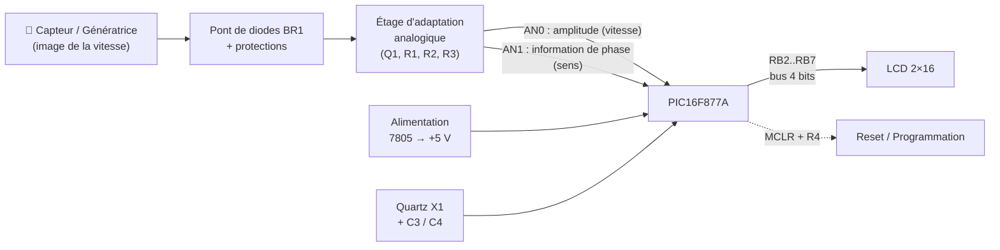
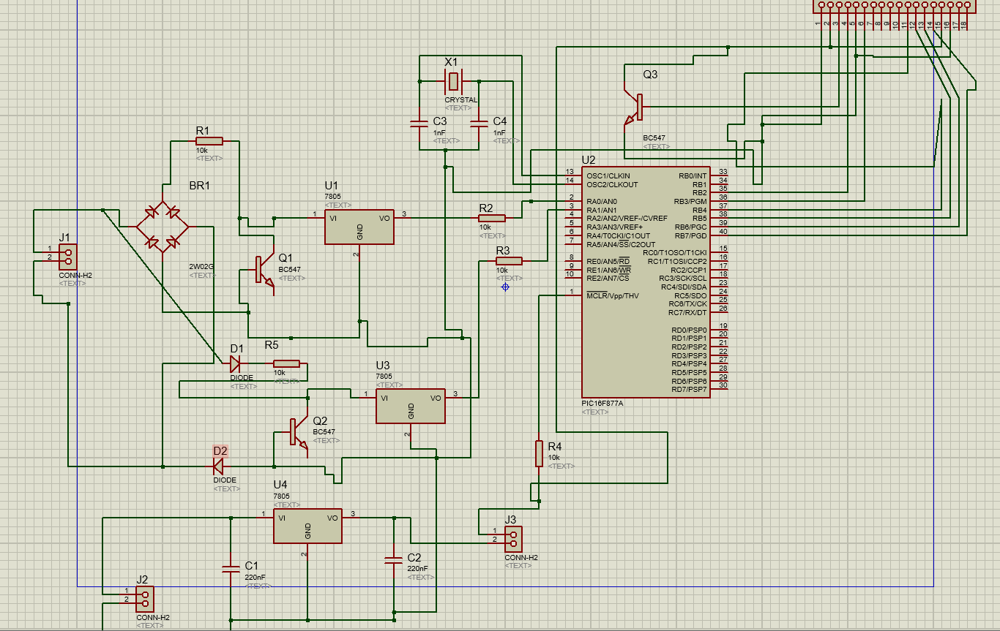
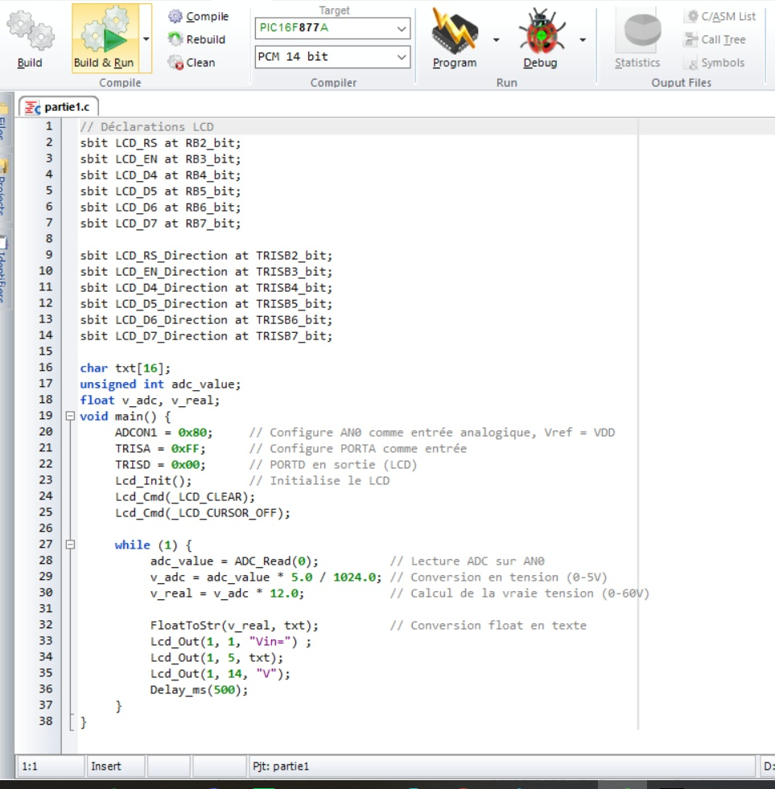
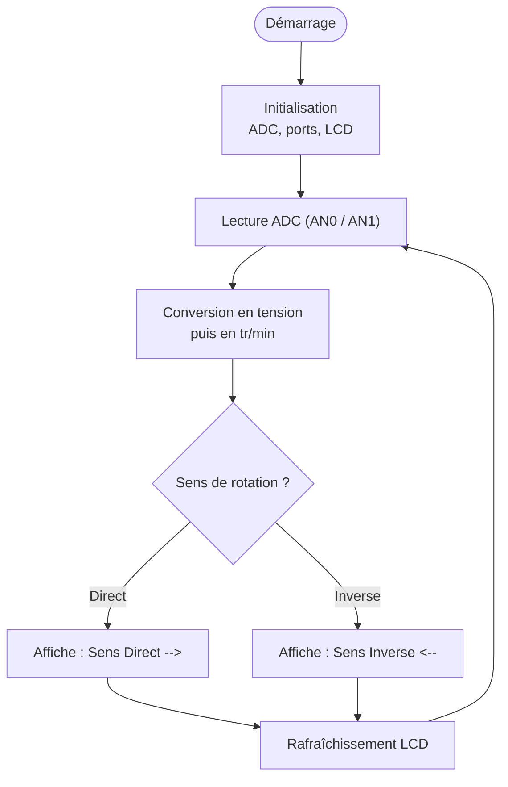
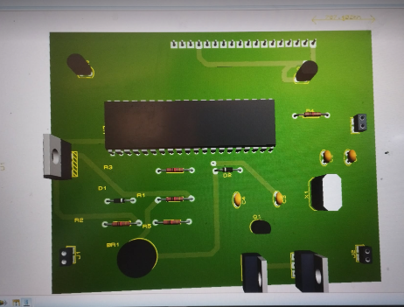
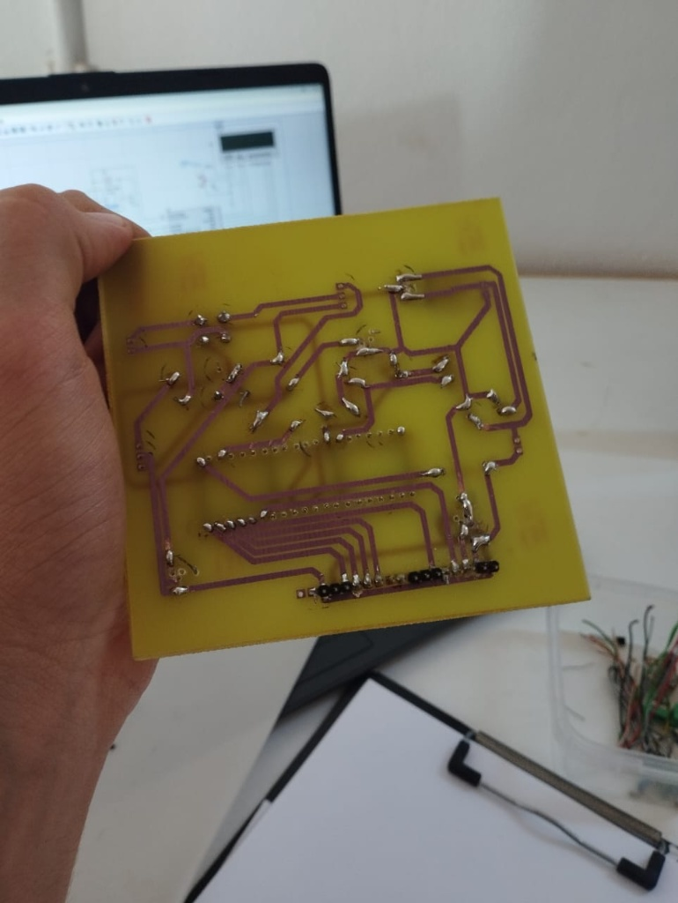
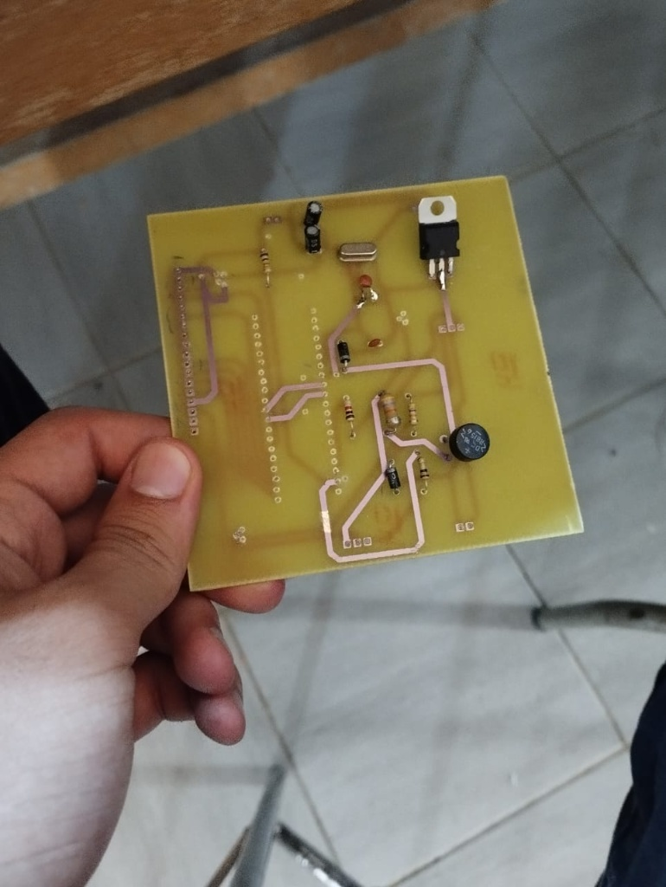
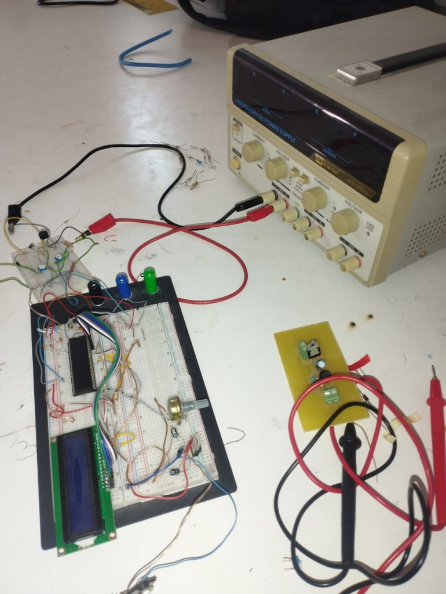
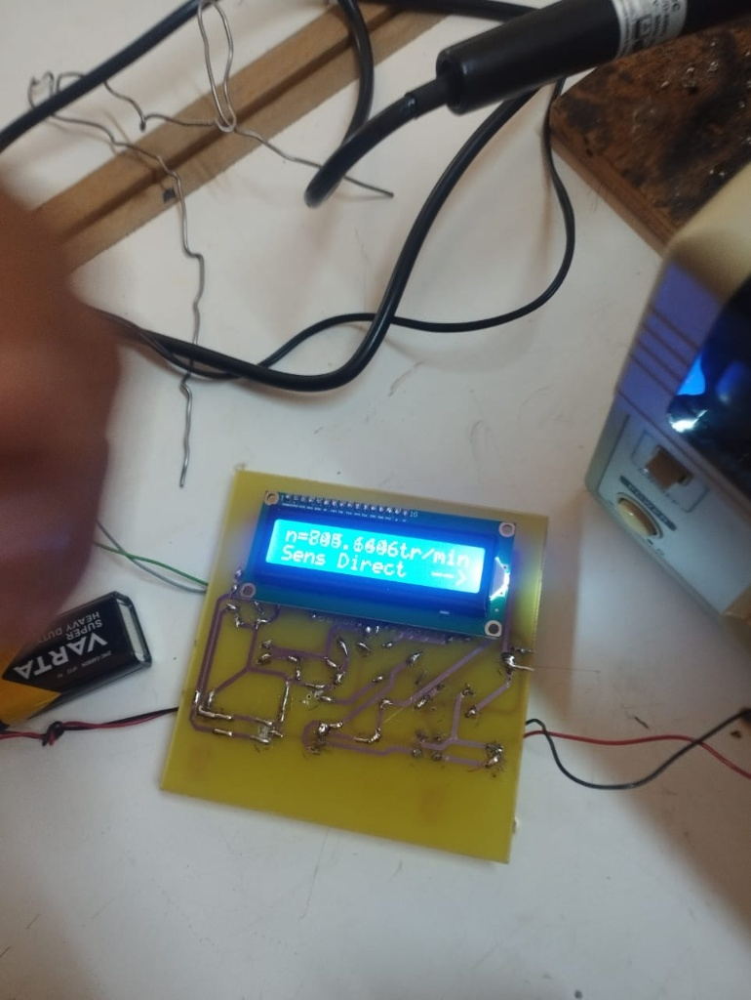

<div align="center">

# ⚙️ Tachymètre Numérique DV
### Mesure de vitesse de rotation et détection du sens de rotation


-orange)




</div>

---

## 📖 Sommaire

1. [Présentation](#-présentation)
2. [Caractéristiques](#-caractéristiques)
3. [Architecture du système](#-architecture-du-système)
4. [Schéma électronique](#-schéma-électronique)
5. [Firmware](#-firmware)
6. [Conception du PCB](#-conception-du-pcb)
7. [Prototypage et tests](#-prototypage-et-tests)
8. [Résultat final](#-résultat-final)
9. [Structure du dépôt](#-structure-du-dépôt)
10. [Compilation et programmation](#-compilation-et-programmation)
11. [Équipe](#-équipe)

---

## 🎯 Présentation

Ce projet consiste en la **conception et la réalisation complète d'un tachymètre numérique** capable de :

- mesurer la **vitesse de rotation d'un moteur** (en tr/min) ;
- détecter son **sens de rotation** (*Sens Direct* / *Sens Inverse*) ;
- afficher les informations en temps réel sur un **afficheur LCD 2×16**.

Il intègre un **étage d'adaptation analogique**, un **micrologiciel embarqué** sur microcontrôleur PIC et une **carte électronique (PCB) personnalisée**, de la saisie du schéma jusqu'à la soudure des composants.

> **Calibrage de l'appareil :** `20 V → 1000 tr/min` (indiqué sur la face avant du boîtier).

---

## 📋 Caractéristiques

| Élément | Détail |
|---|---|
| **Microcontrôleur** | PIC16F877A, quartz externe (X1) |
| **Mesure** | Vitesse de rotation en temps réel (tr/min) |
| **Sens de rotation** | Détection par étage d'adaptation analogique dédié |
| **Affichage** | LCD 2×16 (mode 4 bits) : `n = ... tr/min` + `Sens Direct / Sens Inverse` |
| **Alimentation** | Régulation 5 V par régulateurs 7805 |
| **Entrée de mesure** | Bornier 2 points (J1) / bornes banane en face avant |
| **Firmware** | Langage C (mikroC PRO for PIC) |
| **CAO** | Schéma sous **ISIS** et routage sous **ARES** (Proteus) |
| **Étalonnage** | 20 V ↔ 1000 tr/min |

---

## 🛠️ Architecture du système



### 1. Étage analogique
L'étage d'entrée conditionne le signal provenant du capteur afin qu'il soit **compatible avec les entrées du microcontrôleur** (0–5 V), tout en **extrayant l'information de phase/polarité** nécessaire à la détection du sens de rotation.

- **Pont redresseur BR1 (2W02G)** : met en forme la tension d'entrée.
- **Transistors BC547 (Q1, Q2, Q3)** : commutation / adaptation de niveau.
- **Résistances 10 kΩ (R1–R5)** : polarisation, limitation de courant et rappel (pull-up sur `MCLR`).
- **Régulateurs 7805 (U1, U3, U4)** : alimentation 5 V stabilisée, avec condensateurs de découplage C1/C2 (220 nF).

### 2. Unité de traitement (PIC16F877A)
Le programme :
- acquiert le signal (entrées `RA0/AN0` et `RA1/AN1`) ;
- calcule la **vitesse en tr/min** en temps réel ;
- détermine le **sens de rotation** ;
- pilote l'affichage LCD.

### 3. Affichage
LCD alphanumérique 2×16 connecté en **mode 4 bits** sur le port B :

| Signal LCD | Broche PIC |
|---|---|
| RS | RB2 |
| EN | RB3 |
| D4 | RB4 |
| D5 | RB5 |
| D6 | RB6 |
| D7 | RB7 |

---

## 🔬 Schéma électronique

Schéma saisi sous **ISIS (Proteus)** :



**Blocs principaux :**

| Repère | Composant | Rôle |
|---|---|---|
| J1 | Bornier 2 points | Entrée du signal à mesurer |
| BR1 | Pont 2W02G | Redressement |
| Q1, Q2, Q3 | BC547 | Adaptation / commutation |
| U1, U3, U4 | 7805 | Régulation +5 V |
| U2 | PIC16F877A | Unité de traitement |
| X1, C3, C4 | Quartz + 2×1 nF | Horloge |
| R4 | 10 kΩ | Pull-up de `MCLR` |
| J2, J3 | Borniers | Alimentation / connexions externes |

---

## 💻 Firmware

Le firmware est écrit **entièrement en C** sous **mikroC PRO for PIC** (compilateur PCM 14 bits, cible PIC16F877A).



### Configuration du LCD

```c
// Déclarations LCD (mode 4 bits)
sbit LCD_RS at RB2_bit;
sbit LCD_EN at RB3_bit;
sbit LCD_D4 at RB4_bit;
sbit LCD_D5 at RB5_bit;
sbit LCD_D6 at RB6_bit;
sbit LCD_D7 at RB7_bit;

sbit LCD_RS_Direction at TRISB2_bit;
sbit LCD_EN_Direction at TRISB3_bit;
sbit LCD_D4_Direction at TRISB4_bit;
sbit LCD_D5_Direction at TRISB5_bit;
sbit LCD_D6_Direction at TRISB6_bit;
sbit LCD_D7_Direction at TRISB7_bit;
```

### Acquisition ADC et affichage (test de la chaîne d'acquisition)

Ce programme de validation lit l'entrée analogique `AN0`, reconvertit la tension réelle à partir du pont diviseur d'entrée (facteur ×12) puis l'affiche sur le LCD.

```c
char txt[16];
unsigned int adc_value;
float v_adc, v_real;

void main() {
    ADCON1 = 0x80;    // AN0 en entrée analogique, Vref = VDD
    TRISA  = 0xFF;    // PORTA en entrée
    TRISD  = 0x00;    // PORTD en sortie
    Lcd_Init();       // Initialise le LCD
    Lcd_Cmd(_LCD_CLEAR);
    Lcd_Cmd(_LCD_CURSOR_OFF);

    while (1) {
        adc_value = ADC_Read(0);             // Lecture ADC sur AN0
        v_adc  = adc_value * 5.0 / 1024.0;   // Conversion en tension (0-5 V)
        v_real = v_adc * 12.0;               // Tension réelle (pont diviseur)

        FloatToStr(v_real, txt);
        Lcd_Out(1, 1,  "Vin=");
        Lcd_Out(1, 5,  txt);
        Lcd_Out(1, 14, "V");
        Delay_ms(500);
    }
}
```

### Principe de calcul de la vitesse

Avec l'étalonnage de l'appareil (**20 V ⇔ 1000 tr/min**), la vitesse se déduit de la tension mesurée :

```
n (tr/min) = V_réelle × (1000 / 20) = V_réelle × 50
```

Exemple d'adaptation du code ci-dessus pour afficher la vitesse et le sens
*(esquisse à adapter à votre firmware final : le sens est ici lu sur `RA1`)* :

```c
#define K_TR_MIN_PAR_VOLT  50.0f      // 1000 tr/min / 20 V

float n;

// ... après calcul de v_real ...
n = v_real * K_TR_MIN_PAR_VOLT;

FloatToStr(n, txt);
Lcd_Out(1, 1, "n=");
Lcd_Out(1, 3, txt);
Lcd_Out(1, 11, "tr/min");

if (PORTA.F1)                          // image du sens de rotation
    Lcd_Out(2, 1, "Sens Direct    -->");
else
    Lcd_Out(2, 1, "Sens Inverse   <--");
```

### Logique de fonctionnement



---

## 🧩 Conception du PCB

La carte a été conçue pour être **compacte et robuste**. Les étapes :

1. **Saisie du schéma** sous ISIS (Proteus) ;
2. **Routage des pistes** sous ARES (Proteus) ;
3. **Fabrication** de la carte (simple face), **perçage** et **soudure** complète des composants.

### Vue 3D sous ARES

<div align="center">

</div>

### Carte réalisée

| Face pistes (cuivre) | Face composants |
|:---:|:---:|
|  |  |

---

## 🧪 Prototypage et tests

Avant la réalisation du PCB, le montage a été **validé sur breadboard** avec une alimentation de laboratoire : étage d'adaptation, PIC, LCD et potentiomètre de contraste.

<div align="center">

</div>

### Test sur la carte finale

Premier fonctionnement du PCB soudé : l'afficheur indique la vitesse mesurée et le **sens de rotation** (ici : *Sens Direct*).

<div align="center">

</div>

---

## 🏁 Résultat final

La carte est intégrée dans un **boîtier imprimé en 3D** comprenant :
- l'interrupteur marche/arrêt ;
- l'afficheur LCD (`n = ... tr/min` et `Sens Direct / Sens Inverse`) ;
- les **bornes d'entrée** (rouge / noire) ;
- l'indication de calibrage **`20 V → 1000 tr/min`**.

<div align="center">

</div>

---

## 📁 Structure du dépôt

```text
.
├── README.md
├── firmware/
│   └── partie1.c              # Code source mikroC PRO for PIC
├── proteus/
│   ├── tachymetre.pdsprj      # Projet ISIS / ARES
│   └── ...
└── docs/
    └── image/                 # Photos, schéma, captures
```

> Adaptez cette arborescence à celle de votre dépôt.

---

## 🚀 Compilation et programmation

1. Ouvrir `partie1.c` dans **mikroC PRO for PIC**.
2. Sélectionner la cible **PIC16F877A** et l'horloge correspondant au quartz X1.
3. Compiler (**Build**) pour générer le fichier `.hex`.
4. Programmer le PIC (programmateur compatible, ex. PICkit) puis alimenter la carte.
5. Vérifier l'affichage sur le LCD (ajuster le contraste si besoin).

---

## 👥 Équipe

**Réalisé par :**
- Jaffel Hiba
- Khorchani Maha
- Trigui Youssef
- Mlayeh Salem Amine
- Hamraoui Iheb

**Encadré par :** Mr. Naoui Mohamed
**Établissement :** ENIG
**Année universitaire :** GEA1 — 2024/2025

---

<div align="center">

⭐ *Si ce projet vous est utile, n'hésitez pas à laisser une étoile !*

</div>
